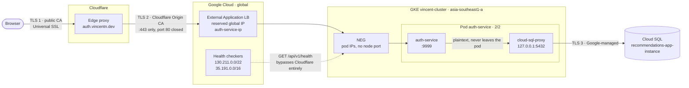
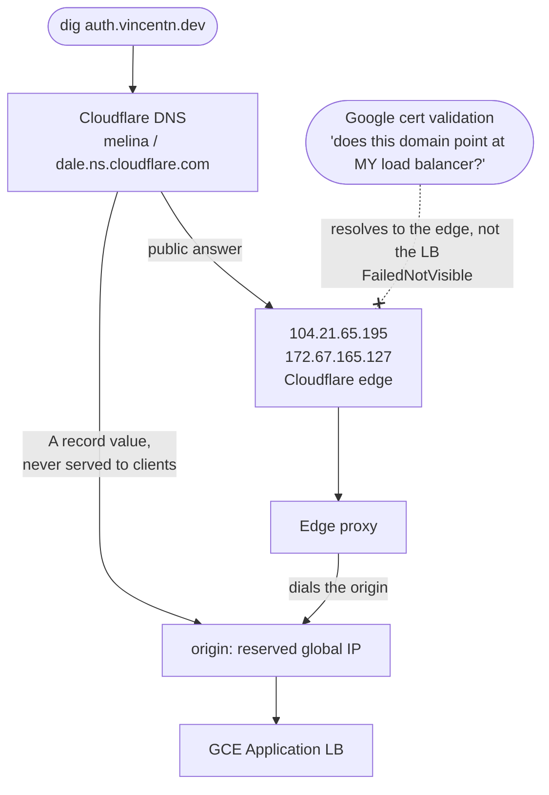
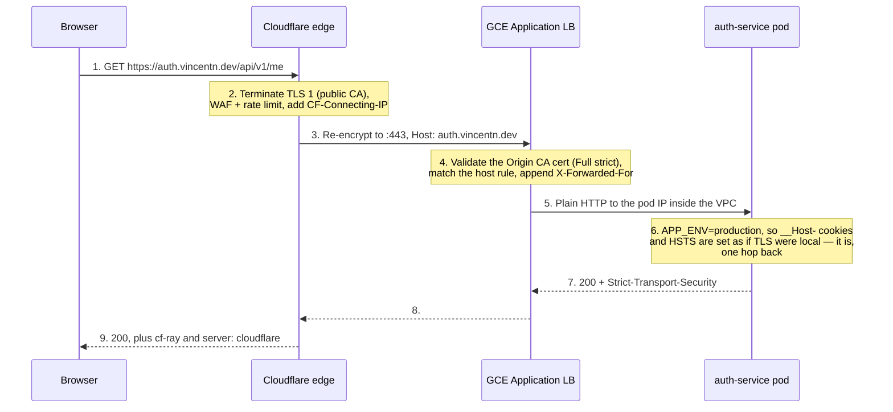

# Phase 2 — `auth.vincentn.dev` on HTTPS through Cloudflare

One linear path from the Phase 1 LoadBalancer to `https://auth.vincentn.dev/api/v1/health`
returning 200, with Cloudflare in front and TLS unbroken from the browser to the pod.

**Supersedes the Google-managed-certificate plan in
[phase-2-domain-tls-oauth.md](./phase-2-domain-tls-oauth.md).** That document assumed DNS
resolved straight to Google. Yours resolves to Cloudflare, and that one fact invalidates its
certificate step — see [Why not a Google-managed certificate](#why-not-a-google-managed-certificate).

| | |
| --- | --- |
| **Goal** | `https://auth.vincentn.dev/api/v1/health` → `200`, valid cert, no plaintext hop |
| **Time** | ~25 min, of which ~15 is waiting on the load balancer to become healthy |
| **Image** | the deployed `0.1.1` — no rebuild needed for *this* phase |
| **Destructive** | yes, in one narrow way: step 5 releases `34.87.12.86` permanently |
| **Does not finish** | Google login. Two code-level blockers remain — [step 9](#step-9--what-still-blocks-google-login) |

---

## What you are building, and why this shape



Two independent TLS hops, which is what Cloudflare calls **Full (strict)**. The browser trusts
hop 1 via a public CA; Cloudflare trusts hop 2 via a certificate Cloudflare itself issued. The
origin certificate is *not* publicly trusted and does not need to be — the only client that will
ever dial that load balancer is Cloudflare's edge.

Three decisions worth understanding before you type anything:

**Why a GCE Ingress and not nginx-ingress.** The single `e2-medium` node is at **926m of 940m
allocatable CPU already requested** (`kubectl describe node`). An in-cluster controller requests
~100m and would sit `Pending` with `Insufficient cpu` forever. A GCE Ingress is provisioned
*outside* the cluster as a Google-managed load balancer and consumes **0m** of node CPU. On this
cluster it is not a preference, it is the only option that schedules.

**Why the public address has to change.** `34.87.12.86` is an **ephemeral regional** address —
it does not appear in `gcloud compute addresses list`, because it is leased to the Phase 1
`Service` object and dies with it. A GCE Ingress additionally requires a **global** address;
regional ones are rejected outright. So you reserve a global address and repoint the Cloudflare
A record at it. Side benefit: the new address survives `kubectl delete ingress`, which the
current one does not.

**Why the orange cloud stays on.** It is what makes the origin address private, absorbs DDoS,
and lets you keep one certificate story. The cost is that certificate validation can no longer
be done by Google — handled in step 3.

### Two things the picture settles

**The A record is not what resolves.** With the proxy on, Cloudflare answers queries with its own
edge addresses and keeps your origin address to itself. This is why `dig` returning Cloudflare
IPs is the *correct* result in step 2, and why a Google-managed certificate can never validate:



**Health checks are a second, separate door into the cluster.** The dashed edge in the topology
above is not decoration: Google's health checkers reach pod IPs directly, with no Cloudflare and
no Host header from you. So a backend can be `UNHEALTHY` while Cloudflare is serving fine, and a
Cloudflare 502 can mean the *health check* path is broken rather than the request path. They fail
independently and are debugged separately.

### One request, hop by hop



Step 5 is the only plaintext hop, and it stays inside Google's VPC between the load balancer and
the pod. Note what step 6 implies: the app never sees `https://`, yet must behave as though it
did. It gets that right only because `APP_ENV` says so — not by sniffing the scheme — which is
why `BASE_URL` has to be the public hostname rather than anything the request reveals.

---

## Step 0 — Preflight

```bash
kubectl config current-context    # gke_vincent-mini-apps-project_asia-southeast1-a_vincent-cluster
gcloud config get account         # vinhnguyentan99@gmail.com
kubectl -n auth get pods          # auth-service  2/2  Running
```

Confirm the HTTP load balancing addon is enabled — the Ingress silently never provisions
without it:

```bash
gcloud container clusters describe vincent-cluster --zone asia-southeast1-a \
  --format='value(addonsConfig.httpLoadBalancing.disabled)'
# empty output = enabled. "True" = disabled, and you must enable it first.
```

And confirm the cluster is VPC-native, which is what makes container-native load balancing
(step 5's `cloud.google.com/neg` annotation) work:

```bash
gcloud container clusters describe vincent-cluster --zone asia-southeast1-a \
  --format='value(ipAllocationPolicy.useIpAliases)'    # => True
```

---

## Step 1 — Reserve the global static IP

```bash
gcloud compute addresses create auth-service-ip --global
gcloud compute addresses describe auth-service-ip --global --format='value(address)'
```

Write the address down — call it `$NEW_IP`. The name `auth-service-ip` is what
`ingress.yaml`'s `kubernetes.io/ingress.global-static-ip-name` annotation refers to; if you
name it anything else, edit the manifest to match or the Ingress will provision a *different*,
ephemeral address and your DNS will point at nothing.

> `--global` is not optional. Drop it and you get a regional address that the `gce` Ingress
> class refuses, with an error that talks about address type rather than about the missing flag.

---

## Step 2 — Repoint the Cloudflare A record

In the Cloudflare dashboard → **DNS → Records**, edit the existing `auth` A record:

| Field | Value |
| --- | --- |
| Type | `A` |
| Name | `auth` |
| IPv4 address | `$NEW_IP` *(replacing `34.87.12.86`)* |
| Proxy status | **Proxied** (orange cloud) — leave it on |
| TTL | Auto |

With the proxy on, this value is Cloudflare's *origin pointer*, not what the public resolves.
Verify the distinction — it is the thing most likely to confuse you later:

```bash
dig +short auth.vincentn.dev        # Cloudflare edge IPs (104.21.x / 172.67.x) -- CORRECT
```

Seeing `$NEW_IP` here would mean the proxy got turned off and your origin is exposed.

---

## Step 3 — Create the Cloudflare Origin Certificate

Cloudflare dashboard → **SSL/TLS → Origin Server → Create Certificate**:

- Private key type: **RSA (2048)** — broadest compatibility with Google's load balancer
- Hostnames: `auth.vincentn.dev` *(add `*.vincentn.dev` too if you will front more services)*
- Certificate Validity: 15 years

Cloudflare shows the certificate and the private key **once**. Copy both to files outside the
repo — the key must never be committed:

```bash
cd "$(mktemp -d)"            # a scratch dir, deliberately not the repo
pbpaste > origin.crt         # paste the "Origin Certificate" block first
# then copy the "Private Key" block in the dashboard and:
pbpaste > origin.key
```

Load them into the cluster as the Secret `ingress.yaml` expects:

```bash
kubectl -n auth create secret tls auth-service-origin-tls \
  --cert=origin.crt --key=origin.key
```

Verify, then destroy the local copies:

```bash
kubectl -n auth get secret auth-service-origin-tls \
  -o jsonpath='{.data.tls\.crt}' | base64 -d | openssl x509 -noout -subject -dates
# subject should name Cloudflare Origin CA; notAfter ~15 years out

shred -u origin.crt origin.key 2>/dev/null || rm -f origin.crt origin.key
```

This Secret is created imperatively and is deliberately **not** in `kustomization.yaml` — the
same rule `auth-service-secrets` follows, so no private key ever lands in git.

### Why not a Google-managed certificate

A `ManagedCertificate` proves domain control by requiring `auth.vincentn.dev` to resolve to
*its* load balancer. Behind the orange cloud it resolves to Cloudflare, so issuance never
completes — it parks in `Provisioning` and then reports `FailedNotVisible`, an error that
describes the symptom and not the cause. The only ways to use one are to turn the proxy off
(giving up Cloudflare entirely) or to move to Certificate Manager with DNS authorization (a
CNAME-based flow, more moving parts than this needs). A Cloudflare Origin certificate needs no
validation at all, issues instantly, and lasts 15 years.

---

## Step 4 — Set Cloudflare SSL mode to Full (strict)

**SSL/TLS → Overview → Configure → Custom → Full (strict)**.

This is the step that makes the origin certificate load-bearing, and the order matters: set it
*after* the Secret exists but it will only start succeeding after step 5 finishes. If you set it
while the origin still has no certificate, Cloudflare returns **525 (SSL handshake failed)** —
expected, and it clears on its own once the Ingress is serving.

Avoid the alternatives, briefly: **Flexible** sends Cloudflare→origin traffic as *plaintext
across the public internet* while showing the browser a padlock, and **Full** (non-strict)
encrypts but validates nothing, so it accepts any certificate from anyone.

While you are in Cloudflare, two settings that matter for an auth API:

- **SSL/TLS → Edge Certificates → Always Use HTTPS: On.** Cloudflare then handles the
  http→https redirect at the edge, which is why `ingress.allow-http: "false"` on the origin is
  safe rather than user-hostile.
- **Caching → Cache Rules:** add a rule for `auth.vincentn.dev/api/*` → **Bypass cache**.
  Cloudflare does not cache `Set-Cookie` responses by default, so this is belt-and-braces — but
  a cached authenticated response is a cross-user data leak, and the default is not worth
  trusting with session cookies.

---

## Step 5 — Apply the manifests

Three files changed, already committed in this repo:

| File | Change |
| --- | --- |
| `k8s/auth-service/ingress.yaml` | **new** — the `gce` Ingress, host rule, TLS secret reference |
| `k8s/auth-service/service.yaml` | `LoadBalancer` → `ClusterIP`, plus `cloud.google.com/neg` |
| `k8s/auth-service/configmap.yaml` | `BASE_URL` + `GOOGLE_OAUTH_REDIRECT_URL` → the real host |
| `k8s/auth-service/kustomization.yaml` | registers `ingress.yaml` |

Dry-run against the API server first — this catches the Service type transition, which is the
only step with a destructive edge:

```bash
kubectl apply -k k8s/auth-service --dry-run=server
```

> **Expect this warning, and ignore it:**
>
> ```
> Warning: annotation "kubernetes.io/ingress.class" is deprecated, please use 'spec.ingressClassName' instead
> ```
>
> It is `kubectl` linting against upstream Kubernetes, which knows nothing about which
> controller is actually running. The object is accepted and the apply succeeds. Do **not** act
> on the advice: `spec.ingressClassName` is not merely unnecessary on GKE, it is *inert* —
> Google's Ingress reference lists the field as **"Any value. This field is ignored"** and states
> that *"you can safely ignore the warning because GKE Ingress continues to rely exclusively on
> the `kubernetes.io/ingress.class` annotation."* Replace the annotation with the field and the
> Ingress matches no controller at all: it is created, looks healthy, and sits with an empty
> `ADDRESS` forever with no error to explain why.
> ([GKE Ingress reference](https://docs.cloud.google.com/kubernetes-engine/docs/concepts/ingress))

Then apply. A ConfigMap without a name hash does not roll the Deployment on its own, so the
restart is required, not a nicety — `make apply-config SVC=auth` exists for exactly this:

```bash
make apply-config SVC=auth
```

**`34.87.12.86` is released here, permanently.** Dropping the Service to `ClusterIP` deletes
the regional load balancer, and since the address was ephemeral it goes back to the pool and
cannot be recovered. That is intended — nothing points at it after step 2.

If `apply` rejects the type change with a complaint about `nodePort`, delete and recreate the
Service (same outcome, the address is going away regardless):

```bash
kubectl -n auth delete svc auth-service && make apply SVC=auth
```

---

## Step 6 — Wait for the load balancer

This is the slow part: **10–15 minutes**, sometimes longer on first creation. The Ingress
reports an address well before it can actually serve traffic, so the address appearing is *not*
the signal to start testing.

```bash
kubectl -n auth get ingress auth-service -w
# ADDRESS should settle on $NEW_IP
```

The real readiness signal is the backend health check passing:

```bash
kubectl -n auth describe ingress auth-service | sed -n '/Annotations/,$p'
# ingress.kubernetes.io/backends:  {"k8s1-...":"HEALTHY"}
```

`UNHEALTHY` or `Unknown` for the first several minutes is normal. Still `UNHEALTHY` after ~10
minutes is a real failure — go to [troubleshooting](#troubleshooting).

Confirm the NEG was created, i.e. that the load balancer is talking to pod IPs rather than
falling back through node ports:

```bash
gcloud compute network-endpoint-groups list --format='table(name,size,zone)'
# one NEG, size 1 -- the single auth-service pod
```

### Where the health check comes from

The GCE load balancer **derives its backend health check from the pod's `readinessProbe`**,
which already targets `/api/v1/health` on port `http`. Nothing extra to configure — but know
the coupling: change that probe path and the load balancer's health check silently follows it.
A mismatch there presents as a `502` from a pod that `kubectl` insists is perfectly healthy.

---

## Step 7 — Verify the chain, hop by hop

Test each hop separately. A single end-to-end curl that fails tells you nothing about *where*.

**Hop 2 — origin, bypassing Cloudflare.** This proves the Ingress, the certificate and the pod
work before Cloudflare is in the picture:

```bash
curl -sS --resolve "auth.vincentn.dev:443:$NEW_IP" \
     --insecure https://auth.vincentn.dev/api/v1/health
# => {"ok":true,"env":"production"}
```

`--insecure` is correct and not a shortcut here: the origin certificate is issued by Cloudflare
Origin CA, which your local trust store does not contain and is not supposed to. Cloudflare's
edge is the only party that should trust it.

Confirm it really is the certificate you installed:

```bash
openssl s_client -connect "$NEW_IP:443" -servername auth.vincentn.dev </dev/null 2>/dev/null \
  | openssl x509 -noout -issuer
# issuer should name Cloudflare Origin SSL CA
```

**Hop 1 — through Cloudflare, as a real browser sees it:**

```bash
curl -sS https://auth.vincentn.dev/api/v1/health
# => {"ok":true,"env":"production"}

curl -sI https://auth.vincentn.dev/api/v1/health | grep -iE 'strict-transport|cf-ray|server'
# strict-transport-security present  -> the app's HSTS, now backed by real TLS
# cf-ray + server: cloudflare        -> confirms you came through the edge
```

**Plaintext is closed:**

```bash
curl -sI http://auth.vincentn.dev/api/v1/health | head -1
# 301 to https (Cloudflare's "Always Use HTTPS"), never a 200
```

---

## Step 8 — Exit criteria for the networking work

- [ ] `gcloud compute addresses describe auth-service-ip --global` returns `$NEW_IP`, `IN_USE`
- [ ] `dig +short auth.vincentn.dev` returns **Cloudflare** IPs, not `$NEW_IP`
- [ ] `kubectl -n auth get secret auth-service-origin-tls` exists; no key file left on disk
- [ ] Cloudflare SSL mode is **Full (strict)**; Always Use HTTPS is on
- [ ] Ingress backend reports `HEALTHY`; one NEG of size 1 exists
- [ ] `https://auth.vincentn.dev/api/v1/health` → `200` with an HSTS header
- [ ] `http://` returns a redirect, not content
- [ ] No `LoadBalancer` Service remains: `kubectl -n auth get svc` shows `ClusterIP`

---

## Step 9 — What still blocks Google login

The networking is finished at step 8. Login is **not**, and neither remaining blocker is
fixable from this repository — both live in `auth-be` and need a new image. Stating them
precisely so they are not discovered one at a time through a browser:

### 9a. `GOOGLE_OAUTH_REDIRECT_URL` is still ignored by the binary

`internal/platform/config/config.go` overrides `BASE_URL` and `FRONTEND_URL` from the
environment but not the redirect URL, so the value compiled into `production.yaml`
(`http://localhost:9999/...`) wins over the ConfigMap entry added in step 5. The fix, beside the
existing lines at `config.go:61-62` and reusing the `envOr` helper already in that file:

```go
config.Auth.GoogleOAuthRedirectURL = envOr("GOOGLE_OAUTH_REDIRECT_URL",
    config.Auth.GoogleOAuthRedirectURL)
```

The fallback is the embedded YAML value, so local development is unaffected. The required-vars
loop at `config.go:85` already rejects an empty value, so no new validation is needed.

### 9b. The `__Host-oauth_tx` cookie is rejected by every browser

`handlers_cookie.go` prefixes cookies with `__Host-` under `APP_ENV=production`
(`cookieNameFor`), and sets `oauth_tx` with `Path: OAuthTxCookiePath` = `/api/v1/auth/google`
(`handlers_cookie.go:84`). The `__Host-` prefix requires **`Path=/` exactly**, along with
`Secure` and no `Domain`. A `__Host-` cookie with any other path is discarded by the browser
without a warning the server can see.

The consequence is specific: the login redirect appears to work, then the callback fails with
*no `oauth_tx` cookie*. It has been latent all along — locally `APP_ENV` is not `production` so
no prefix is applied, and on the Phase 1 HTTP deployment login was already blocked by 9a. It
surfaces the moment 9a is fixed.

Two ways out, and they genuinely trade off:

- **`Path: "/"` for `oauth_tx`** — keeps the `__Host-` subdomain-shadowing protection, loses the
  path scoping. The cookie is HttpOnly and sealed, and it lives for `loginTxTTL` only.
- **Exempt `oauth_tx` from the prefix** — keeps path scoping, loses the prefix guarantee.

Prefer the first. `__Host-` defends against a sibling subdomain under `vincentn.dev` setting a
cookie that this service would read; path scoping only narrows which of *this* origin's own
routes receive it, and every one of those routes is this same service. Note that the comment on
`OAuthTxCookiePath` and `TestOAuthTxCookiePathCoversRoutes` both encode the current intent, so
the change needs to touch them too.

### Then, in order

1. Fix 9a and 9b, bump to `0.1.2`, build `--platform linux/amd64` (the nodes are amd64; a
   native arm64 build dies on the node with `exec format error`).
2. Set `FRONTEND_URL` in `configmap.yaml` to the real SPA origin. It is both the post-login
   redirect target and the *only* allowed CORS origin (`main.go:55`), so a wrong value breaks
   login and every XHR simultaneously, the latter visible only in the browser console.
3. Pin the new digest in `deployment.yaml`, then `make apply-config SVC=auth`.
4. GCP console → **APIs & Services → Credentials** → the OAuth client → **Authorized redirect
   URIs**, add exactly:
   ```
   https://auth.vincentn.dev/api/v1/auth/google/callback
   ```
   Byte for byte — scheme, host, path, no trailing slash. Google compares the literal string and
   returns `redirect_uri_mismatch` without hinting which character differs. Add the SPA origin
   to **Authorized JavaScript origins** if the frontend initiates login.
5. In a browser: visit `/api/v1/auth/google/login`, complete consent, land on `FRONTEND_URL`
   with session + CSRF cookies set, then `GET /api/v1/me`. That last call is the one that proves
   the whole chain — session cookie → DB lookup through the Cloud SQL proxy → authenticated
   response.

---

## Troubleshooting

| Symptom | Cause | Fix |
| --- | --- | --- |
| Ingress `ADDRESS` stays empty for >5 min | No controller claimed it | You "fixed" the deprecation warning. ingress-gce ignores `spec.ingressClassName`; restore `kubernetes.io/ingress.class: "gce"`. |
| `Warning: annotation "kubernetes.io/ingress.class" is deprecated` | kubectl linting upstream advice | Nothing. Expected on every apply, and acting on it breaks the Ingress — see [step 5](#step-5--apply-the-manifests). |
| Cloudflare **525** SSL handshake failed | Origin has no working cert on 443 | Expected until step 6 completes. After that: verify `auth-service-origin-tls` exists in `auth` and matches the host in `spec.tls.hosts`. |
| Cloudflare **526** invalid SSL certificate | Full (strict) and the origin cert does not validate | The certificate is not a Cloudflare Origin CA cert, or its hostname does not cover `auth.vincentn.dev`. Re-issue in step 3. |
| Cloudflare **502/504** | Origin backend `UNHEALTHY` | `kubectl -n auth describe ingress auth-service`. Check the readinessProbe path still answers 200 — the LB health check is derived from it. |
| Backend `UNHEALTHY` forever | Health check cannot reach the pod | Confirm the NEG exists and has size 1. If the firewall was customised, GCE health checkers need `130.211.0.0/22` and `35.191.0.0/16` allowed to the pod port. |
| 404 from the load balancer, pods healthy | Host header did not match | The Ingress rule is host-scoped to `auth.vincentn.dev`. Requests to the bare IP match nothing — by design. Use `--resolve` as in step 7. |
| `FailedNotVisible` on a ManagedCertificate | Validating a proxied domain | You are on the superseded plan. Google cannot validate behind the orange cloud; use the origin certificate instead. |
| Cert warning in the browser | Origin cert served to the public | The proxy is off for that record. `dig` must return Cloudflare IPs. |
| Cookies missing after login | `__Host-` prefix violation | [Step 9b](#9b-the-__host-oauth_tx-cookie-is-rejected-by-every-browser). |
| New pod `Pending`, `Insufficient cpu` | Node is at 98% requested CPU | Pre-existing constraint. `maxUnavailable: 1 / maxSurge: 0` in `deployment.yaml` is what keeps rollouts from deadlocking — see `manifest-reference.md`. |

## Rollback

The Ingress is additive; reverting is a Service type change plus a DNS edit.

```bash
kubectl -n auth delete ingress auth-service
# restore type: LoadBalancer in service.yaml, then
make apply SVC=auth
kubectl -n auth get svc auth-service -o jsonpath='{.status.loadBalancer.ingress[0].ip}'
```

That address will be a **new** ephemeral IP — `34.87.12.86` is gone for good — so the Cloudflare
A record has to be repointed again. Keep `auth-service-ip` reserved either way; an unused global
address costs a small amount monthly and re-reserving an address you already published in DNS is
not possible.

---

## References

- [GKE Ingress for HTTP(S) Load Balancing](https://docs.cloud.google.com/kubernetes-engine/docs/concepts/ingress)
- [Container-native load balancing](https://docs.cloud.google.com/kubernetes-engine/docs/how-to/container-native-load-balancing)
- [Static IPs for Ingress](https://docs.cloud.google.com/kubernetes-engine/docs/tutorials/configuring-domain-name-static-ip)
- [Cloudflare Origin CA certificates](https://developers.cloudflare.com/ssl/origin-configuration/origin-ca/)
- [Cloudflare encryption modes](https://developers.cloudflare.com/ssl/origin-configuration/ssl-modes/)
- [`__Host-` cookie prefix requirements](https://developer.mozilla.org/en-US/docs/Web/HTTP/Cookies#cookie_prefixes)
- Repo: [manifest-reference.md](./manifest-reference.md) · [parameters.md](./parameters.md) · [troubleshooting.md](./troubleshooting.md)
