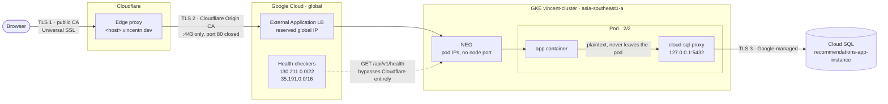

# How the edge is wired

Shared by all three services. Each gets its own GCE Ingress and global IP, behind one Cloudflare
zone. Values per service are in [gke-parameters.md](./gke-parameters.md).



Two independent TLS hops — Cloudflare's **Full (strict)**. The browser trusts hop 1 via a public
CA; Cloudflare trusts hop 2 via a certificate Cloudflare itself issued. The origin certificate is
not publicly trusted and does not need to be: the only client that ever dials these load
balancers is Cloudflare's edge.

The one plaintext hop is LB → pod, inside Google's VPC. The app therefore never sees `https://`
yet must behave as though it did — it gets that right only because `APP_ENV=production` says so,
never by sniffing the scheme. That is why `BASE_URL` must be the public hostname rather than
anything the request reveals.

---

## Four things that surprise people

**The A record is not what resolves.** With the orange cloud on, Cloudflare answers queries with
its own edge addresses and keeps the origin address to itself. `dig +short <host>` returning
Cloudflare IPs (`104.21.x` / `172.67.x`) is the **correct** result. Seeing the origin IP there
means the proxy got turned off and the origin is exposed.

**Health checks are a second, separate door.** Google's health checkers reach pod IPs directly,
with no Cloudflare and no Host header. So a backend can be `UNHEALTHY` while Cloudflare serves
fine, and a Cloudflare 502 can mean the *health-check* path is broken rather than the request
path. They fail independently and are debugged separately.

**The LB health check is derived from the pod's `readinessProbe`** — nothing extra to configure,
but change that probe path and the load balancer's check silently follows. A mismatch presents as
a `502` from a pod `kubectl` insists is healthy.

**Hosts must stay one label deep.** A wildcard `*.vincentn.dev` covers exactly one label:
`league-be.vincentn.dev` matches, `league.be.vincentn.dev` does not, and the bare apex does not
either. Two labels deep would need a fresh `*.be.vincentn.dev` Origin CA cert *and* paid Advanced
Certificate Manager at the edge, since free Universal SSL also stops at one label. **Use a hyphen,
not a dot** — `recommendations-be`, not `recommendations.be`.

---

## Why this shape and not the alternatives

| Choice | Why not the alternative |
| --- | --- |
| **GCE Ingress**, not nginx-ingress | The node is at 926m of 940m allocatable CPU. An in-cluster controller requests ~100m and would sit `Pending` forever. A GCE Ingress is provisioned *outside* the cluster and costs **0m** of node CPU. Not a preference — the only option that schedules. |
| **Cloudflare Origin CA cert**, not a Google `ManagedCertificate` | A managed cert proves domain control by requiring the host to resolve to *its* load balancer. Behind the orange cloud it resolves to Cloudflare, so issuance parks in `Provisioning` then reports `FailedNotVisible`. An Origin cert needs no validation, issues instantly, lasts 15 years. |
| **One Ingress per service**, not one shared | An Ingress can only reference Services in **its own namespace**, and these live in `auth`, `recommendations` and `league`. A global address also backs exactly one forwarding rule, so the IPs cannot be shared either. |
| **Full (strict)**, not Flexible or Full | **Flexible** sends Cloudflare→origin traffic as plaintext across the public internet while showing the browser a padlock. **Full** (non-strict) encrypts but validates nothing, accepting any certificate from anyone. |
| **ClusterIP**, not LoadBalancer | The Ingress owns the public address. A `LoadBalancer` Service would bill a second one on an address nothing resolves to, and container-native LB never uses a node port. |

Genuinely sharing one load balancer across namespaces needs the **Gateway API** (one `Gateway`
plus an `HTTPRoute` per namespace). That is the right end state, but it is not enabled on this
cluster (`kubectl get gatewayclass` → `the server doesn't have a resource type`) and adopting it
means migrating the two live services off their working Ingresses. Revisit when the duplication
actually hurts.

---

## Cloudflare zone settings

Zone-level, so they already apply to every host — nothing to redo per service.

| Setting | Value | Why |
| --- | --- | --- |
| SSL/TLS → Overview | **Full (strict)** | Makes the origin certificate load-bearing |
| SSL/TLS → Edge Certificates → Always Use HTTPS | **On** | Cloudflare handles http→https at the edge, which is what makes `ingress.allow-http: "false"` safe rather than user-hostile |
| Caching → Cache Rules | `*/api/*` → **Bypass cache** | Cloudflare does not cache `Set-Cookie` by default, so this is belt-and-braces — but a cached authenticated response is a cross-user data leak |
| DNS record proxy status | **Proxied** (orange) | Keeps the origin address private, absorbs DDoS |

---

## Adding a service to the edge

The zone settings above are done. Per service:

```bash
# 1. Reserve a GLOBAL address. --global is not optional: a regional address is
#    rejected by the gce Ingress class, with an error about address type rather
#    than about the missing flag.
gcloud compute addresses create <svc>-service-ip --global
gcloud compute addresses describe <svc>-service-ip --global --format='value(address)'

# 2. Copy the wildcard Origin cert into the new namespace. Secrets are
#    namespaced, so each service holds a copy, not a reference.
kubectl -n auth get secret auth-service-origin-tls -o json \
  | jq '.metadata = {name: "<svc>-service-origin-tls", namespace: "<svc>"}' \
  | kubectl apply -f -

# 3. Confirm it covers the host -- -checkhost answers directly instead of
#    making you read SANs.
kubectl -n <svc> get secret <svc>-service-origin-tls \
  -o jsonpath='{.data.tls\.crt}' | base64 -d \
  | openssl x509 -noout -checkhost <host>.vincentn.dev

# 4. Cloudflare -> DNS -> Add record: A, name <host>, the step-1 address,
#    Proxied, TTL Auto.

# 5. Apply, then budget 10-15 min. Do NOT re-apply -- that restarts propagation.
make apply SVC=<svc>
kubectl -n <svc> get ingress <svc>-service -w
```

The Ingress reports an address well before it can serve, so the address appearing is **not** the
signal to start testing. The real signal is the backend health check:

```bash
kubectl -n <svc> describe ingress <svc>-service | grep backends
# ingress.kubernetes.io/backends: {"k8s1-...":"HEALTHY"}
```

`UNHEALTHY` or `Unknown` for the first several minutes is normal; still `UNHEALTHY` after ~10 min
is a real failure.

### Expect this warning on every apply, and ignore it

```
Warning: annotation "kubernetes.io/ingress.class" is deprecated, please use 'spec.ingressClassName' instead
```

`kubectl` is linting against upstream Kubernetes, which knows nothing about which controller is
running. **Do not act on it.** On GKE `spec.ingressClassName` is not merely unnecessary, it is
*inert* — Google's Ingress reference lists the field as "Any value. This field is ignored". Replace
the annotation with the field and the Ingress matches no controller at all: it is created, looks
healthy, and sits with an empty `ADDRESS` forever with no error to explain why.

---

## Verifying a host, hop by hop

Test each hop separately. One end-to-end curl that fails tells you nothing about *where*.

```bash
IP=$(gcloud compute addresses describe <svc>-service-ip --global --format='value(address)')

# hop 2 -- origin, bypassing Cloudflare. --insecure is correct, not a shortcut:
# the cert is Cloudflare Origin CA, which your trust store does not contain and
# is not supposed to.
curl -sS --resolve "<host>.vincentn.dev:443:$IP" --insecure \
  https://<host>.vincentn.dev/api/v1/health

# it really is the cert you installed
openssl s_client -connect "$IP:443" -servername <host>.vincentn.dev </dev/null 2>/dev/null \
  | openssl x509 -noout -issuer          # issuer names Cloudflare Origin SSL CA

# hop 1 -- through Cloudflare, as a browser sees it
curl -sS https://<host>.vincentn.dev/api/v1/health
curl -sI https://<host>.vincentn.dev/api/v1/health | grep -iE 'cf-ray|server:'

# plaintext must not serve
curl -sI http://<host>.vincentn.dev/api/v1/health | head -1      # 301, never 200
```

---

## Edge symptoms

| Symptom | Cause | Fix |
| --- | --- | --- |
| Ingress `ADDRESS` empty >5 min | No controller claimed it | You "fixed" the deprecation warning. Restore `kubernetes.io/ingress.class: "gce"` |
| Cloudflare **525** handshake failed | Origin has no working cert on 443 | Expected until the LB finishes. After that, verify the TLS secret exists in the namespace and matches `spec.tls.hosts` |
| Cloudflare **526** invalid cert | Full (strict), origin cert does not validate | Not a Cloudflare Origin CA cert, or its hostname does not cover the host |
| Cloudflare **502/504** | Backend `UNHEALTHY` | `describe ingress`. Check the readinessProbe path still answers 200 — the LB check derives from it |
| Backend `UNHEALTHY` forever | Health check cannot reach the pod | Confirm the NEG exists, size 1: `gcloud compute network-endpoint-groups list`. If the firewall was customised, allow `130.211.0.0/22` and `35.191.0.0/16` to the pod port |
| 404 from the LB, pods healthy | Host header did not match | Rules are host-scoped by design; the bare IP matches nothing. Use `--resolve` |
| Cert warning in a browser | Origin cert served to the public | The proxy is off for that record. `dig` must return Cloudflare IPs |
| New pod `Pending`, `Insufficient cpu` | Node at 98% requested CPU | Pre-existing. See [cpu-capacity-options.md](./recommendations-service/cpu-capacity-options.md) |

---

## References

- [GKE Ingress for HTTP(S) Load Balancing](https://docs.cloud.google.com/kubernetes-engine/docs/concepts/ingress)
- [Container-native load balancing](https://docs.cloud.google.com/kubernetes-engine/docs/how-to/container-native-load-balancing)
- [Static IPs for Ingress](https://docs.cloud.google.com/kubernetes-engine/docs/tutorials/configuring-domain-name-static-ip)
- [Cloudflare Origin CA certificates](https://developers.cloudflare.com/ssl/origin-configuration/origin-ca/)
- [Cloudflare encryption modes](https://developers.cloudflare.com/ssl/origin-configuration/ssl-modes/)
