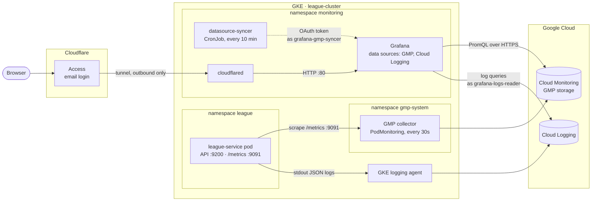

# league-service — Grafana

Step-by-step setup of Grafana on `league-cluster`: league's metrics from Google Managed
Prometheus (GMP), league's logs from Cloud Logging, and a dashboard. To open it from the
internet, continue with [grafana-public-access.md](grafana-public-access.md). To query logs with
LogQL as well, see [grafana-loki.md](grafana-loki.md).



Run everything from the repo root with `kubectl` pointed at `league-cluster`.

```bash
PROJECT_ID=vincent-mini-apps-project
```

---

## 1. Scrape league's metrics

`helm/values/league.yaml` turns on the chart's `PodMonitoring`:

```yaml
podMonitoring:
  enabled: true
metricsPort: 9091   # league-be serves /metrics on 9091, outside the Service
```

Set `metricsPort` **in the same commit** as the image bump to a league-be release that serves
`/metrics` on its own port. With an older image, leave it out and the scrape uses `http`. Deploy
as usual (`make apply SVC=league` or merge to master).

Check: in Grafana (step 6), `up{namespace="league"}` returns `1`. A `0` means GMP reaches the pod
but its `/metrics` doesn't answer.

---

## 2. Google service accounts

One for the data source syncer (reads metrics), one for Grafana (reads logs). Workload Identity
binds each to a Kubernetes service account in `monitoring`.

```bash
SYNC=grafana-gmp-syncer@${PROJECT_ID}.iam.gserviceaccount.com
LOGS=grafana-logs-reader@${PROJECT_ID}.iam.gserviceaccount.com

gcloud iam service-accounts create grafana-gmp-syncer --project ${PROJECT_ID}
gcloud iam service-accounts create grafana-logs-reader --project ${PROJECT_ID}

for role in roles/monitoring.viewer roles/iam.serviceAccountTokenCreator; do
  gcloud projects add-iam-policy-binding ${PROJECT_ID} \
    --member=serviceAccount:${SYNC} --role=${role} --condition=None
done
gcloud projects add-iam-policy-binding ${PROJECT_ID} \
  --member=serviceAccount:${LOGS} --role=roles/logging.viewer --condition=None

gcloud iam service-accounts add-iam-policy-binding ${SYNC} --role=roles/iam.workloadIdentityUser \
  --member="serviceAccount:${PROJECT_ID}.svc.id.goog[monitoring/default]"
gcloud iam service-accounts add-iam-policy-binding ${LOGS} --role=roles/iam.workloadIdentityUser \
  --member="serviceAccount:${PROJECT_ID}.svc.id.goog[monitoring/grafana]"
```

---

## 3. Install Grafana

All settings are in `helm/monitoring/grafana-values.yaml`. Don't add `--set`; the next upgrade
would drop it.

```bash
helm repo add grafana https://grafana.github.io/helm-charts
helm repo update

helm upgrade --install grafana grafana/grafana --version 10.5.15 \
  -n monitoring --create-namespace -f helm/monitoring/grafana-values.yaml

kubectl -n monitoring annotate serviceaccount default \
  iam.gke.io/gcp-service-account=${SYNC}
```

This also installs the Cloud Logging plugin and its data source (step 7).

---

## 4. Log in

```bash
kubectl -n monitoring get secret grafana -o jsonpath='{.data.admin-password}' | base64 -d; echo
kubectl -n monitoring port-forward svc/grafana 3000:80
```

Open <http://localhost:3000>, log in as `admin`, then **Profile → Change password**. After that the
Secret's value is stale: Grafana only reads it when its database is first created.

---

## 5. GMP data source and syncer

GMP needs a Google OAuth token that expires hourly. The syncer CronJob writes a fresh one into
the data source every 10 minutes.

1. **Connections → Data sources → Add data source → Prometheus**. Name `GMP`, turn on
   **Default**, URL
   `https://monitoring.googleapis.com/v1/projects/vincent-mini-apps-project/location/global/prometheus`.
   **Save** without testing, then copy the **UID** from the address bar
   (`…/datasources/edit/<UID>`).
2. **Administration → Users and access → Service accounts → Add service account**: name
   `datasource-syncer`, role `Admin`. **Add service account token**, no expiration, copy the
   `glsa_…` token.
3. Deploy the syncer:

```bash
DATASOURCE_UIDS=<UID>
GRAFANA_API_TOKEN=<glsa_ token>
GRAFANA_API_ENDPOINT=http://grafana.monitoring.svc:80

curl -s https://raw.githubusercontent.com/GoogleCloudPlatform/prometheus-engine/v0.17.2/cmd/datasource-syncer/datasource-syncer.yaml \
  | sed 's|$DATASOURCE_UIDS|'"$DATASOURCE_UIDS"'|; s|$GRAFANA_API_ENDPOINT|'"$GRAFANA_API_ENDPOINT"'|; s|$GRAFANA_API_TOKEN|'"$GRAFANA_API_TOKEN"'|; s|$PROJECT_ID|'"$PROJECT_ID"'|;' \
  | kubectl -n monitoring apply -f -

kubectl -n monitoring wait --for=condition=complete job/datasource-syncer-init --timeout=120s \
  && kubectl -n monitoring logs job/datasource-syncer-init   # "Updated Grafana data source uids"
```

The endpoint is the Service port `:80`, not Grafana's `:3000`.

---

## 6. Check both data sources

- **GMP → Save & test** succeeds. **Explore → GMP → `up{namespace="league"}`** returns one series
  per league pod.
- **Cloud Logging → Test** says *Successfully queried logs from GCP project
  vincent-mini-apps-project*.

---

## 7. Query logs

**Explore → Cloud Logging**. Base filter for league:

```text
resource.type="k8s_container"
resource.labels.namespace_name="league"
resource.labels.container_name="league-service"
```

Add a line to narrow it:

| Looking for | Add |
| --- | --- |
| Warnings and errors | `severity>=WARNING` |
| Server errors | `jsonPayload.status>=500` |
| One request | `jsonPayload.request_id="<id>"` |
| One endpoint | `jsonPayload.path="/api/v1/me"` |
| Text anywhere | `"no session cookie"` |

Full guide — log fields, the filter language, `gcloud`, following one request:
[cloud-logging.md](cloud-logging.md).

---

## 8. Build the dashboard

**Dashboards → New → New dashboard**, saved in a folder `league`.

**Variables** (Dashboard settings → Variables), data source `GMP`, query type **Label values**,
metric `up`:

| Name | Label | Label filter | Options |
| --- | --- | --- | --- |
| `namespace` | `namespace` | — | pick `league`, then save with **Update default variable values** |
| `pod` | `pod` | `namespace = $namespace` | Multi-value, Include All |

**Panels.** `{…}` stands for `{namespace="$namespace", pod=~"$pod"}`.

| Panel | PromQL | Unit |
| --- | --- | --- |
| Uptime | `time() - process_start_time_seconds{…}` | s |
| CPU | `rate(process_cpu_seconds_total{…}[$__rate_interval])` | short |
| Resident memory | `process_resident_memory_bytes{…}` | bytes (IEC) |
| Goroutines | `go_goroutines{…}` | short |
| GC pause p75 | `go_gc_duration_seconds{…, quantile="0.75"}` | s |
| Request rate | `sum by (route) (rate(http_requests_total{…}[$__rate_interval]))` | req/s |
| 5xx ratio | `sum(rate(http_requests_total{…, code=~"5.."}[$__rate_interval])) / sum(rate(http_requests_total{…}[$__rate_interval]))` | percent (0.0-1.0) |
| Latency p95 | `histogram_quantile(0.95, sum by (le, route) (rate(http_request_duration_seconds_bucket{…}[$__rate_interval])))` | s |

The request panels need a league-be release with the request metrics middleware.

Add a **Logs** panel with data source **Cloud Logging**, the base filter from step 7 and
`severity>=WARNING`. It follows the dashboard's time range.

**Save**, and export the JSON (**Share → Export → Save to file**) to keep it in git.

---

## 9. Removing it

Take it off the internet first: [grafana-public-access.md §6](grafana-public-access.md#6-removing-it).
Then:

```bash
kubectl -n monitoring delete -f https://raw.githubusercontent.com/GoogleCloudPlatform/prometheus-engine/v0.17.2/cmd/datasource-syncer/datasource-syncer.yaml
helm -n monitoring uninstall grafana
kubectl delete namespace monitoring

for role in roles/monitoring.viewer roles/iam.serviceAccountTokenCreator; do
  gcloud projects remove-iam-policy-binding ${PROJECT_ID} --member=serviceAccount:${SYNC} --role=${role} --condition=None
done
gcloud projects remove-iam-policy-binding ${PROJECT_ID} --member=serviceAccount:${LOGS} --role=roles/logging.viewer --condition=None
gcloud iam service-accounts delete ${SYNC}
gcloud iam service-accounts delete ${LOGS}
```

To stop GMP billing, set `podMonitoring.enabled: false` in `helm/values/league.yaml` and deploy.
